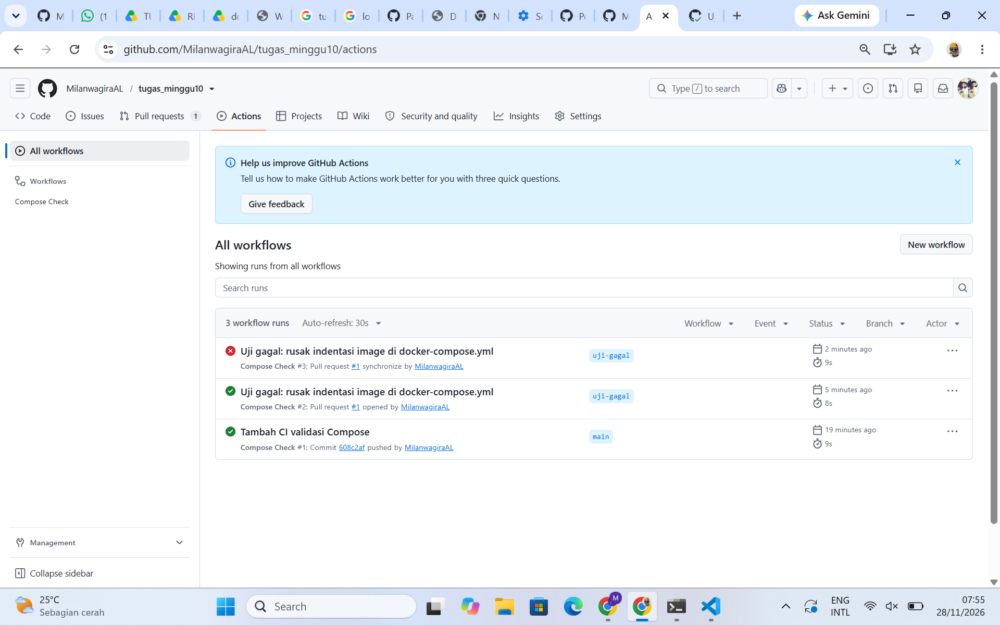
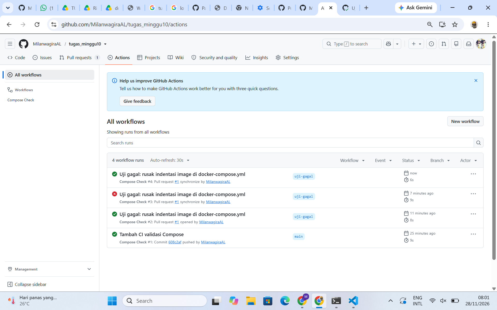
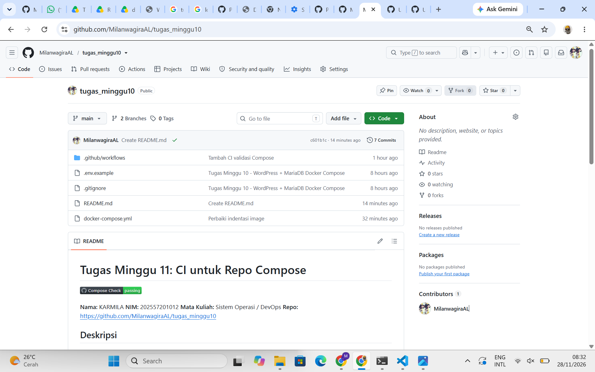

# Tugas Minggu 11: CI untuk Repo Compose

**Nama:** KARMILA
**NPM:** 202557201012
**Mata Kuliah:** Teknologi Open Source
**Repo:** https://github.com/MilanwagiraAL/tugas_minggu10

## Deskripsi
Tugas ini melanjutkan repo Tugas Minggu 10 (WordPress + MariaDB) dengan menambahkan Continuous Integration (CI) menggunakan GitHub Actions. CI ini berfungsi untuk mengecek otomatis setiap ada Pull Request, apakah file `docker-compose.yml` masih valid atau tidak.

## Cara Kerja CI
Workflow `.github/workflows/compose-check.yml` akan jalan otomatis saat ada Pull Request ke branch `main`:
1. Checkout kode
2. Setup Docker Buildx
3. Validasi `docker compose config` - memastikan file compose tidak ada yang salah format

Jika ada yang salah, misalnya indentasi `image:` rusak, maka CI akan gagal (merah) dan PR tidak bisa di-merge sembarangan.

## Bukti
### 1. CI Berhasil (Hijau)

### 2. PR Gagal (Merah)

### 3. Badge di README

## Link PR
PR yang sudah di-merge:
https://github.com/MilanwagiraAL/tugas_minggu10/pull/1

PR ini membuktikan CI bekerja: pertama dibuat merah dengan cara merusak indentasi `image:` di `docker-compose.yml`, lalu diperbaiki sampai hijau dan berhasil di-merge ke `main`.

## Kendala yang Dihadapi
- Awalnya bingung karena repo masih bernama `tugas_minggu10`, padahal ini sudah Tugas 11.
- Sempat gagal memahami cara membuat PR merah, ternyata harus merusak indentasi `image:` agar `docker compose config` error.
- Kesulitan saat upload foto bukti ke folder `bukti/` di dalam repo.

## Refleksi
Dari tugas ini saya belajar bahwa CI sangat membantu untuk mencegah file yang rusak masuk ke branch utama. Tanpa CI, kesalahan kecil seperti indentasi saja bisa membuat aplikasi tidak jalan. Dengan CI, kesalahan langsung ketahuan sebelum di-merge.
